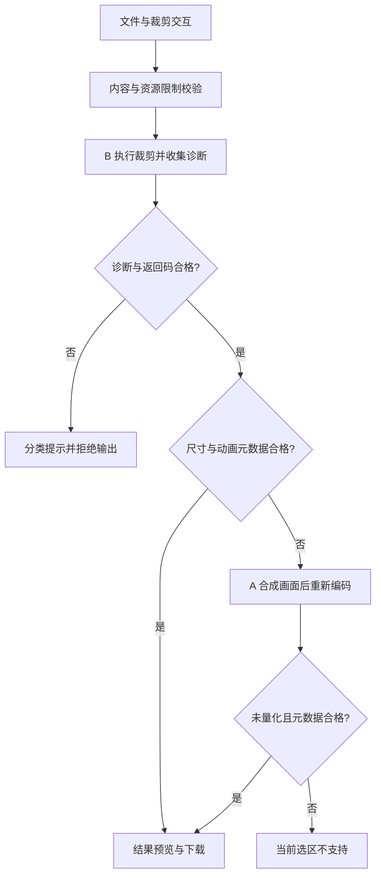

# GIF Crop 第一版技术方案

日期：2026-10-30。状态：开发基线，正式产品尚未实现。

本方案依据 [research.md](research.md) 和 [双引擎验证最终结论](test-resources/crop-benchmark/双引擎验证最终结论.md)。功能范围以本文件中结合本次讨论确定的规则为准；早期材料中的默认正方形等描述不再沿用。

## 1. 决策

采用 **浏览器本地处理、静态工具页面、B 主处理、A 有条件兜底**。第一版不依赖服务端 GIF 处理，也不等待 Gifsicle 1.98 WASM 编译。

目前已验证的是实验页：Chrome、Edge 各 45 个输入、159 条记录。148 个有效输出全部通过画面与动画元数据检查，其中 B 交付 116 条、A 兜底 32 条；3 个合法复杂选区被拒绝。另有 7 个明确异常输入被拒绝、1 个缺结束标记的输入容错接受。这些数字是固定样本的结果，不是线上成功率或任意 GIF 都正确的证明。

## 2. 功能范围

### 2.1 主流程

选择本地 GIF → 校验 → 原图与默认选区 → 调整选区 → 点击 Crop → 查看结果 → 下载 GIF。

| 功能 | 第一版规则 |
|---|---|
| 输入 | 一次选择一个本地 GIF；文件内容必须符合支持的 GIF 格式 |
| 默认选区 | 自由比例矩形，覆盖整个 GIF 画布 |
| 拖动 | 鼠标拖动改变位置，拖动边或角改变宽高；选区始终在原图范围内 |
| 手动尺寸 | 宽、高两个输入框，单位是原图像素，只接受有效范围内的正整数 |
| 正方形 | 同一个裁剪框锁定 1:1，不建立独立裁剪引擎或第二套数据 |
| 信息区 | 文件大小、原图宽高、帧数、当前选区宽高；不显示中心坐标或 X/Y 编辑框 |
| 更新 | 拖动和有效尺寸修改立即更新选区及信息区，不自动执行 GIF 编码 |
| 执行 | 点击 Crop 后处理全部动画帧，生成 GIF |
| 结果 | 编辑区下方展示裁剪后的动画预览、结果尺寸、大小和下载按钮 |
| 再次编辑 | 改变选区或文件，立即清除旧结果及下载入口，需重新点击 Crop |

自由比例模式下宽高独立修改。切换正方形时，以当前选区中心为参考，边长取当前宽高的较小值，并约束在画布内；中心只用于内部计算。正方形模式修改任一尺寸时，另一边同步变化。切回自由比例保留当前选区，不恢复另一份隐藏选区。

调整尺寸时优先保留选区左上角；若新尺寸使选区超出画布，平移回合法范围。输入框允许短暂的空值等编辑状态，但此时禁用 Crop 并显示校验提示，不能将其当成 0 执行。

### 2.2 本版不做

圆形、圆角、自动去留白、去背景、时间截取、压缩、旋转、格式转换、通用修复、批量、URL 导入、视频导入、云存储、账号和付费系统。正式页面不提供 A/B 引擎选择，也不显示实验日志。

首版文案以英文为主，对应 research.md 的英文搜索词；不做语言切换。本文中的中文提示用于定义语义，实施时提供对应英文文案。

## 3. 技术栈

| 层次 | 选择 | 理由与边界 |
|---|---|---|
| 页面与构建 | Vite + 原生 JavaScript ES Modules + CSS | 延续已验证工程，单页交互规模小，暂不引入框架及后端 |
| 选区交互 | 自有轻量 DOM 覆盖层 + Pointer Events | 同一套原图坐标模型处理拖动、缩放及输入；不让静态图片裁剪库承担 GIF 编码 |
| 原图和结果预览 | img + Blob URL | 浏览器播放动画；不在主线程逐帧解码原图 |
| 主处理 B | gifsicle-wasm-browser 1.5.19，现有基于 1.92 的核心 | 复用已验证诊断适配与显式画布参数；不升级依赖或另换编译产物 |
| 兜底 A | gifuct-js 2.1.2 + gifenc 1.0.3 | 复用局部帧合成、disposal、透明及精确调色板路径；拒绝量化结果 |
| 后台处理 | Web Worker + 可转移 ArrayBuffer | 页面负责交互，Worker 负责校验与 GIF 处理 |
| 验证 | 现有 Playwright、Chrome/Edge、Python/Pillow 与原始 GIF 块检查 | 像素参考与元数据检查分开，保留解码器差异说明 |
| 交付形式 | 静态构建产物 web/dist | 可部署到静态托管；本计划只准备发布包，不自动发布 |

Vite 沿用实验工程锁定的 7.1.7；Node 开发环境以当前已使用的 22.22.1 为基线。保留锁文件及实际版本，不使用浮动 latest。现有库的嵌入式 WASM 随站点资源加载，不使用远程第三方 CDN 加载处理引擎。

## 4. 页面与坐标模型

编辑区由原图 img 和位于同一容器中的选区覆盖层组成。自由比例模式提供移动区和边/角缩放手柄；正方形模式保持比例约束。触摸交互复用 Pointer Events，实际手机支持须另行实测。

唯一的选区状态为原图整数像素坐标：

```js
const selection = { x: 0, y: 0, width: imageWidth, height: imageHeight };
```

- CSS 显示尺寸只用于渲染，不能直接传给裁剪引擎。
- 根据图片实际显示区域换算指针坐标；布局变化后重新测量图片边界。
- 选区统一取整、约束到画布，禁止宽高为 0、负数或越界。
- 不在两套组件中分别维护选区，避免数字输入和拖动相互不同步。
- 拖动期间只更新覆盖层和宽高，必要时用 requestAnimationFrame 合并渲染。
- 宽高输入、模式切换和 Crop 可键盘操作；选区获得焦点后可用方向键移动。

## 5. 本地处理架构



页面同时只处理一个任务，处理中禁用文件选择、裁剪控件和重复提交。显示真实的加载/处理状态，不展示没有依据的百分比进度。成功、失败或超时后均恢复操作。

外层 Worker 负责隔离任务；B 的现有封装内部还会创建 Worker，不能宣传只使用一个 Worker 或已复用 WASM 实例。首次加载引擎、处理耗时分别记录。

主线程保留原文件，向 Worker 发送副本并转移副本的所有权。任务结束释放 Worker、临时 Blob URL 和大数组；替换文件或结果时撤销旧 URL。超时终止任务 Worker，再次处理时重新创建，不能只在界面上停止等待。

## 6. 双引擎规则

### 6.1 输入校验

文件选择器使用 accept 提示 GIF 类型，但后缀和 MIME 只作辅助。以 GIF87a/GIF89a 文件头、容器块结构、画布及子帧范围、帧信息为实际校验依据；不能因浏览器给出的 MIME 为空就拒绝真实 GIF。容器扫描不能替代 LZW 解码语义校验，后者仍需引擎诊断。

### 6.2 B 主处理

复用 cropBDiagnostic，而不是无诊断的 B 基线。参数保持：

```text
--crop X,Y+WxH input.gif -o /out/result.gif --logical-screen WxH
```

这里的 WxH 是裁剪选区尺寸。显式设置逻辑画布，避免输出画布自动收缩。不附加 unoptimize、压缩、减色或修改时间的参数。

记录完整诊断和退出码，只允许已经核实的普通警告：使用局部调色板、背景色不在调色板，以及匹配的固定续行。未知诊断、非零退出、缺少结果或适配器不匹配均拒绝，不盲目切换 A。

现有诊断适配会检查固定版本封装中的标记并获取 CLI 返回值，只改封装 JS，不改 GIF 核心。生产迁移时保留版本校验及说明；依赖升级后必须重新适配和回归，不能静默继续。

### 6.3 何时尝试 A

B 正常生成结果后，检查输出画布尺寸、帧数、每帧原始延迟、循环扩展是否存在及其数值。仅在这些兼容性检查不符时尝试 A。

A 必须沿用已验证的局部帧偏移、透明和 disposal 合成逻辑。只有 quantizedFrames 为 0，且输出元数据检查也合格，才允许交付。需要量化、A 不支持的扩展或再次失败均拒绝输出。

不能因为 B 报损坏而改用 A 强行生成图片。不能将视觉等价的合帧默认为满足“帧数和逐帧延迟保持”的既定要求。

### 6.4 正确性声明

生产运行时有元数据和诊断检查，但没有每次完整逐帧比较的独立正确性证明。独立像素比对是离线测试验收步骤。公开文案只承诺实际支持范围，不使用“任意 GIF”“绝对无损”“无限大小”“自动修复全部 GIF”。

## 7. 状态与错误协议

页面状态：empty → loading → ready → processing → success / error。错误恢复后保留可用原图与选区，不展示失败任务的下载入口。

处理层返回结构化错误码和诊断，页面统一映射文案。已有原型主要使用错误字符串，迁移时需要补充分类，不能把所有非零退出都标为文件损坏。

| 错误码 | 判定依据 | 用户提示语义 |
|---|---|---|
| INVALID_GIF | 文件头或容器明显无效 | 请选择有效的 GIF 文件 |
| CORRUPT_GIF | 截断、无效 LZW 引用等明确损坏诊断 | GIF 文件数据损坏或不完整，请重新导出后再试 |
| UNSUPPORTED_CROP | A 需要量化或结果仍不满足动画要求 | 暂时无法在保持颜色和动画信息的情况下裁剪此选区，请调整选区或更换文件 |
| RESOURCE_LIMIT | 大小、像素量等限制或明确内存不足 | 此 GIF 超出当前处理范围，请使用更小的文件 |
| TIMEOUT | 任务超过超时时间 | 处理时间过长，已停止本次任务，请使用更小的文件或重试 |
| UNSUPPORTED_ENV | Worker/WASM 不可用或资源加载受阻 | 当前浏览器环境无法运行此工具，请尝试受支持的浏览器 |
| PROCESSING_FAILED | 未分类诊断、无输出、非预期异常 | 暂时无法处理此 GIF，请尝试其他文件 |

缺结束标记但可完整处理的输入延续已验证的容错策略；不称为通用修复。超时、内存不足、加载失败不能映射为文件损坏。低层诊断仅保留在本地开发日志中，不直接展示命令行堆栈。

## 8. 资源限制与浏览器范围

以下是开发起始防护参数，**尚不是经过容量验证的最终产品上限**。集中放在 config.js，开发计划中的容量测试通过后再定版：

| 参数 | 起始值 |
|---|---:|
| 文件大小 | 20 MiB |
| 单帧画布像素 | 4,194,304 |
| 帧数 | 500 |
| 画布宽 × 高 × 帧数 | 60,000,000 |
| 单次请求超时 | 60 秒 |

文件大小在读入前检查；帧数及总帧像素量在扫描时尽早拦截。超过上限不继续解码。当前已测的约 11MB、1024×768、60 帧样本保留在验收中，不将它直接当作手机容量证据。

目前有实证支持桌面 Chrome/Edge。手机布局和触摸交互需要开发，手机真机与 Safari/Firefox 尚未通过验收。能力检测只判断能否运行 Worker/WASM，不能代替浏览器正确性验证；发布支持说明必须对应实际测试范围。

## 9. SEO、隐私与发布形式

- 一个静态主页面承接 crop gif、gif crop、gif cropper、crop gif online，不为同义词复制页面。
- title、H1、功能说明、使用步骤和支持限制放在初始 HTML，工具交互由 JS 增强。
- canonical、robots、sitemap 根据实际域名生成；域名未确定前不填虚构正式地址。
- 文件字节只在浏览器内存、Worker 和 Blob URL 中处理；不上传，不默认写入持久存储。第三方脚本不能访问或上传文件内容。
- 如接入统计，只记录选择、处理成功、分类失败、下载等事件，不记录原文件名、内容、图片或 Blob URL。统计服务接入不属于核心裁剪的前置条件。
- 只打包 web 的生产资源。测试 GIF、用户样本、原生 exe、SDK、完整 runs 日志均不进入发布目录。
- 部署前确认 Worker、Blob URL、WASM 加载及资源缓存策略在目标托管环境实际可用。
- 库许可和底层核心的分发条件分别核对，保留所需许可证及来源说明；不能仅凭封装包标记 MIT 就认定整个 WASM 的许可条件。本文件不替代法律结论。

## 10. 建议目录与复用方式

```text
gifcrop_project/
  research.md
  第一版技术方案.md
  第一版开发计划.md
  web/                        # 新建正式产品工程
    index.html
    package.json
    package-lock.json
    public/                   # 仅生产静态资源
    src/
      main.js
      styles.css
      config.js
      crop-selection.js       # 原图坐标、模式与输入约束
      crop-overlay.js         # 指针和覆盖层渲染
      gif/
        inspect.js
        engine-a.js
        engine-b.js
        hybrid.js
        worker.js
        client.js
        errors.js
  test-resources/              # 保留实验、样本与证据
    crop-benchmark/
    codec-corpus/
```

优先复用实验工程的 gif-meta.js、engine-a.js、engine-b.js 中诊断路径、engine-hybrid.js、worker.js、client.js。初次迁移保留处理算法，按正式页面需求补错误码、资源释放及限制。实验目录保持可复现，不整体改造成产品目录。

生产实现成为正式工具的处理入口；回归工具需能运行生产 Worker，避免只测试旧实验代码。保留原 A/B 基线供诊断，不把多个未同步的 H 实现同时当成正式版本。

## 11. 完成定义

功能、交互、错误恢复、生产 Worker 的 45 输入回归、结果下载、正式构建均按 [第一版开发计划](第一版开发计划.md) 验收。已知三个复杂选区继续明确拒绝，属于支持边界，不能为了通过数量改为量化交付。发现新的错误成功输出时暂停发布并定位原因。

本方案定版的是实现路线和验收规则。容量参数、手机/其他内核支持、线上资源策略仍须实际测试；1.98 WASM 下载保持暂停，不是当前开发的阻塞项。
